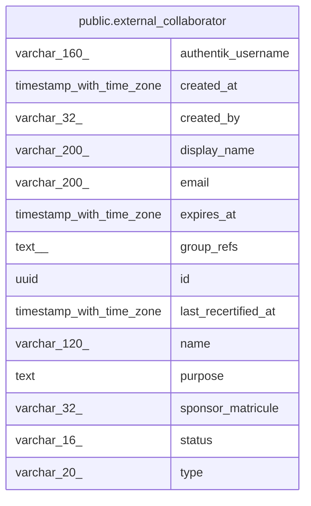

# public.external_collaborator

## Columns

| Name                | Type                     | Default                        | Nullable | Children | Parents | Comment |
| ------------------- | ------------------------ | ------------------------------ | -------- | -------- | ------- | ------- |
| authentik_username  | varchar(160)             |                                | true     |          |         |         |
| created_at          | timestamp with time zone | now()                          | false    |          |         |         |
| created_by          | varchar(32)              |                                | false    |          |         |         |
| display_name        | varchar(200)             |                                | false    |          |         |         |
| email               | varchar(200)             |                                | false    |          |         |         |
| expires_at          | timestamp with time zone |                                | true     |          |         |         |
| group_refs          | text[]                   | '{}'::text[]                   | false    |          |         |         |
| id                  | uuid                     | gen_random_uuid()              | false    |          |         |         |
| last_recertified_at | timestamp with time zone |                                | true     |          |         |         |
| name                | varchar(120)             |                                | false    |          |         |         |
| purpose             | text                     |                                | false    |          |         |         |
| sponsor_matricule   | varchar(32)              |                                | false    |          |         |         |
| status              | varchar(16)              | 'requested'::character varying | false    |          |         |         |
| type                | varchar(20)              |                                | false    |          |         |         |

## Constraints

| Name                               | Type        | Definition                                                                                                                                                                                               |
| ---------------------------------- | ----------- | -------------------------------------------------------------------------------------------------------------------------------------------------------------------------------------------------------- |
| external_collaborator_pkey         | PRIMARY KEY | PRIMARY KEY (id)                                                                                                                                                                                         |
| external_collaborator_status_check | CHECK       | CHECK (((status)::text = ANY ((ARRAY['requested'::character varying, 'active'::character varying, 'expired'::character varying, 'disabled'::character varying, 'flagged'::character varying])::text[]))) |
| external_collaborator_type_check   | CHECK       | CHECK (((type)::text = ANY ((ARRAY['contractor'::character varying, 'auditor'::character varying, 'broker'::character varying, 'partner'::character varying])::text[])))                                 |

## Indexes

| Name                          | Definition                                                                                           |
| ----------------------------- | ---------------------------------------------------------------------------------------------------- |
| external_collaborator_pkey    | CREATE UNIQUE INDEX external_collaborator_pkey ON public.external_collaborator USING btree (id)      |
| uq_external_collaborator_name | CREATE UNIQUE INDEX uq_external_collaborator_name ON public.external_collaborator USING btree (name) |

## Relations

---

> Generated by [tbls](https://github.com/k1LoW/tbls)
