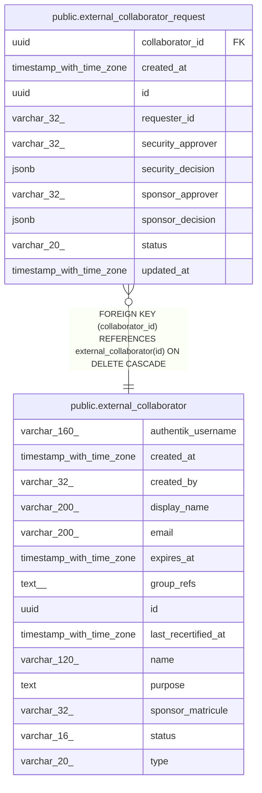

# public.external_collaborator_request

## Columns

| Name              | Type                     | Default                      | Nullable | Children | Parents                                                         | Comment |
| ----------------- | ------------------------ | ---------------------------- | -------- | -------- | --------------------------------------------------------------- | ------- |
| collaborator_id   | uuid                     |                              | false    |          | [public.external_collaborator](public.external_collaborator.md) |         |
| created_at        | timestamp with time zone | now()                        | false    |          |                                                                 |         |
| id                | uuid                     | gen_random_uuid()            | false    |          |                                                                 |         |
| requester_id      | varchar(32)              |                              | false    |          |                                                                 |         |
| security_approver | varchar(32)              |                              | true     |          |                                                                 |         |
| security_decision | jsonb                    |                              | true     |          |                                                                 |         |
| sponsor_approver  | varchar(32)              |                              | true     |          |                                                                 |         |
| sponsor_decision  | jsonb                    |                              | true     |          |                                                                 |         |
| status            | varchar(20)              | 'pending'::character varying | false    |          |                                                                 |         |
| updated_at        | timestamp with time zone | now()                        | false    |          |                                                                 |         |

## Constraints

| Name                                               | Type        | Definition                                                                                                                                                                 |
| -------------------------------------------------- | ----------- | -------------------------------------------------------------------------------------------------------------------------------------------------------------------------- |
| external_collaborator_request_collaborator_id_fkey | FOREIGN KEY | FOREIGN KEY (collaborator_id) REFERENCES external_collaborator(id) ON DELETE CASCADE                                                                                       |
| external_collaborator_request_pkey                 | PRIMARY KEY | PRIMARY KEY (id)                                                                                                                                                           |
| external_collaborator_request_status_check         | CHECK       | CHECK (((status)::text = ANY ((ARRAY['pending'::character varying, 'approved'::character varying, 'denied'::character varying, 'cancelled'::character varying])::text[]))) |

## Indexes

| Name                               | Definition                                                                                                      |
| ---------------------------------- | --------------------------------------------------------------------------------------------------------------- |
| external_collaborator_request_pkey | CREATE UNIQUE INDEX external_collaborator_request_pkey ON public.external_collaborator_request USING btree (id) |
| ix_ec_request_collaborator         | CREATE INDEX ix_ec_request_collaborator ON public.external_collaborator_request USING btree (collaborator_id)   |

## Relations

---

> Generated by [tbls](https://github.com/k1LoW/tbls)
