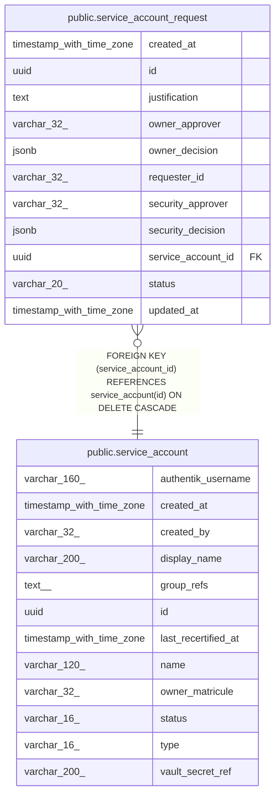

# public.service_account

## Columns

| Name                | Type                     | Default                        | Nullable | Children                                                            | Parents | Comment |
| ------------------- | ------------------------ | ------------------------------ | -------- | ------------------------------------------------------------------- | ------- | ------- |
| authentik_username  | varchar(160)             |                                | true     |                                                                     |         |         |
| created_at          | timestamp with time zone | now()                          | false    |                                                                     |         |         |
| created_by          | varchar(32)              |                                | false    |                                                                     |         |         |
| display_name        | varchar(200)             |                                | false    |                                                                     |         |         |
| group_refs          | text[]                   | '{}'::text[]                   | false    |                                                                     |         |         |
| id                  | uuid                     | gen_random_uuid()              | false    | [public.service_account_request](public.service_account_request.md) |         |         |
| last_recertified_at | timestamp with time zone |                                | true     |                                                                     |         |         |
| name                | varchar(120)             |                                | false    |                                                                     |         |         |
| owner_matricule     | varchar(32)              |                                | false    |                                                                     |         |         |
| status              | varchar(16)              | 'requested'::character varying | false    |                                                                     |         |         |
| type                | varchar(16)              |                                | false    |                                                                     |         |         |
| vault_secret_ref    | varchar(200)             |                                | true     |                                                                     |         |         |

## Constraints

| Name                         | Type        | Definition                                                                                                                                   |
| ---------------------------- | ----------- | -------------------------------------------------------------------------------------------------------------------------------------------- |
| service_account_pkey         | PRIMARY KEY | PRIMARY KEY (id)                                                                                                                             |
| service_account_status_check | CHECK       | CHECK (((status)::text = ANY ((ARRAY['requested'::character varying, 'active'::character varying, 'disabled'::character varying])::text[]))) |
| service_account_type_check   | CHECK       | CHECK (((type)::text = ANY ((ARRAY['qa'::character varying, 'm2m'::character varying, 'automation'::character varying])::text[])))           |

## Indexes

| Name                    | Definition                                                                               |
| ----------------------- | ---------------------------------------------------------------------------------------- |
| service_account_pkey    | CREATE UNIQUE INDEX service_account_pkey ON public.service_account USING btree (id)      |
| uq_service_account_name | CREATE UNIQUE INDEX uq_service_account_name ON public.service_account USING btree (name) |

## Relations

---

> Generated by [tbls](https://github.com/k1LoW/tbls)
