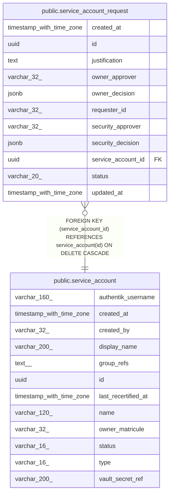

# public.service_account_request

## Columns

| Name               | Type                     | Default                      | Nullable | Children | Parents                                             | Comment |
| ------------------ | ------------------------ | ---------------------------- | -------- | -------- | --------------------------------------------------- | ------- |
| created_at         | timestamp with time zone | now()                        | false    |          |                                                     |         |
| id                 | uuid                     | gen_random_uuid()            | false    |          |                                                     |         |
| justification      | text                     |                              | false    |          |                                                     |         |
| owner_approver     | varchar(32)              |                              | true     |          |                                                     |         |
| owner_decision     | jsonb                    |                              | true     |          |                                                     |         |
| requester_id       | varchar(32)              |                              | false    |          |                                                     |         |
| security_approver  | varchar(32)              |                              | true     |          |                                                     |         |
| security_decision  | jsonb                    |                              | true     |          |                                                     |         |
| service_account_id | uuid                     |                              | false    |          | [public.service_account](public.service_account.md) |         |
| status             | varchar(20)              | 'pending'::character varying | false    |          |                                                     |         |
| updated_at         | timestamp with time zone | now()                        | false    |          |                                                     |         |

## Constraints

| Name                                            | Type        | Definition                                                                                                                                                                 |
| ----------------------------------------------- | ----------- | -------------------------------------------------------------------------------------------------------------------------------------------------------------------------- |
| service_account_request_pkey                    | PRIMARY KEY | PRIMARY KEY (id)                                                                                                                                                           |
| service_account_request_service_account_id_fkey | FOREIGN KEY | FOREIGN KEY (service_account_id) REFERENCES service_account(id) ON DELETE CASCADE                                                                                          |
| service_account_request_status_check            | CHECK       | CHECK (((status)::text = ANY ((ARRAY['pending'::character varying, 'approved'::character varying, 'denied'::character varying, 'cancelled'::character varying])::text[]))) |

## Indexes

| Name                           | Definition                                                                                                     |
| ------------------------------ | -------------------------------------------------------------------------------------------------------------- |
| idx_sa_request_service_account | CREATE INDEX idx_sa_request_service_account ON public.service_account_request USING btree (service_account_id) |
| service_account_request_pkey   | CREATE UNIQUE INDEX service_account_request_pkey ON public.service_account_request USING btree (id)            |

## Relations

---

> Generated by [tbls](https://github.com/k1LoW/tbls)
